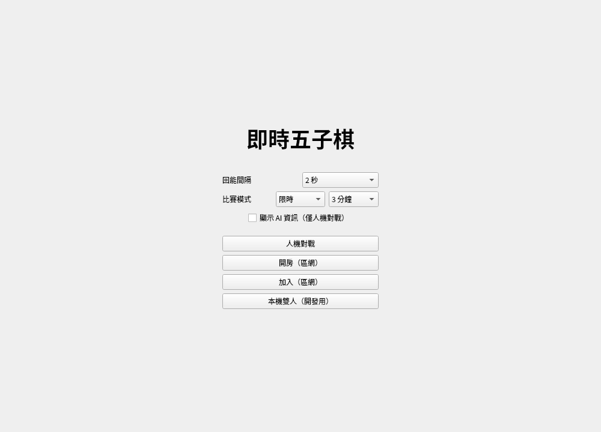
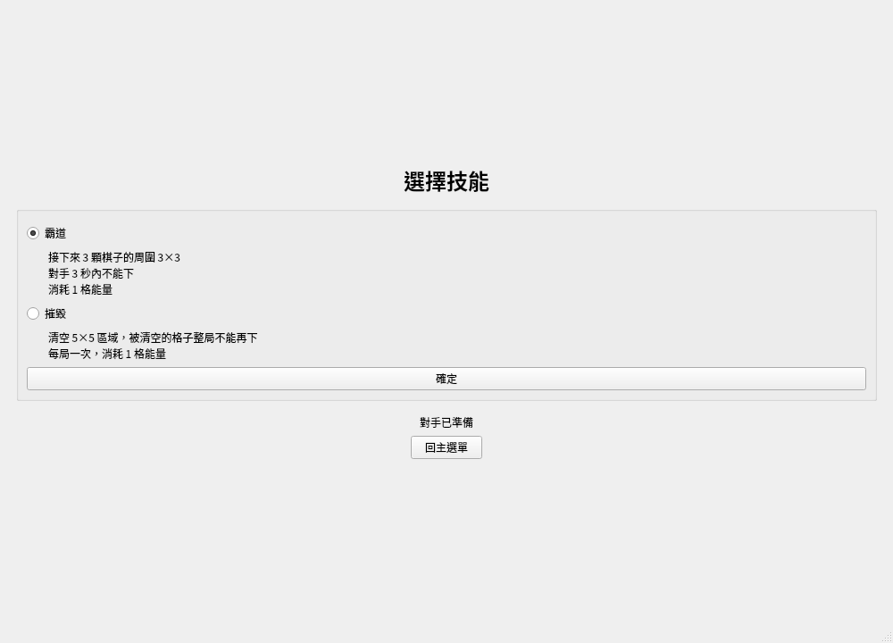
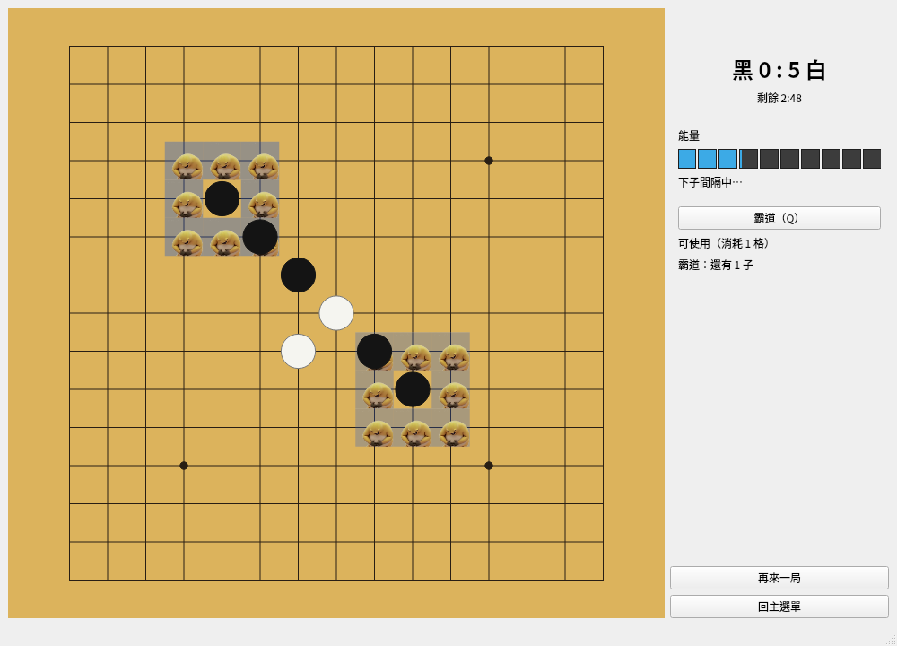

# 即時五子棋

不輪流的五子棋：雙方用「能量」即時下子，連成五子就消除並得分，對局在時間到或分數達標時結束。每位玩家開局前選一項技能（霸道或摧毀），可以和 AI 對戰，也可以在區網和另一台電腦對戰。

C++17 / Qt 6 / CMake / GoogleTest。規則見 [`docs/spec.md`](docs/spec.md)，架構見 [`docs/design.md`](docs/design.md)。

|主選單|技能選擇|對局（霸道禁區）|
|---|---|---|
||||

## 建置

需要：

- 支援 C++17 的編譯器（GCC、Clang 或 MSVC）
- CMake 3.21 以上
- Qt 6：Core、Network、Widgets、Multimedia
- GoogleTest 會在設定時由 CMake 自動下載，不必另外安裝

Debian / Ubuntu 可以這樣安裝：

```bash
sudo apt install build-essential cmake qt6-base-dev qt6-multimedia-dev
```

建置與執行：

```bash
cmake -B build -DCMAKE_BUILD_TYPE=Debug   # 設定
cmake --build build -j                    # 建置
./build/gomoku                            # 執行
ctest --test-dir build --output-on-failure   # 測試（沒有螢幕的環境請加 QT_QPA_PLATFORM=offscreen）
```

## 怎麼玩

### 主選單

開局前設定回能間隔與比賽模式（區網對戰由主機設定）：

- **回能間隔**：每隔多久回 1 格能量，0.5–10 秒，預設 2 秒。
- **比賽模式**：限時（5、3、1 分鐘，或展示延長賽用的 3 秒），或達分（5–100 分，預設 20）。
- **顯示 AI 資訊**：只用在人機對戰，打開後另外顯示 AI 的能量與技能。

|模式|說明|
|---|---|
|人機對戰|你是黑方，AI 是白方|
|開房（區網）|你是黑方，畫面會顯示本機 IP，等對手加入|
|加入（區網）|輸入主機的 IP，你是白方|
|本機雙人（開發用）|同一台電腦兩個人操作，雙方資訊都會顯示，供手動測試用|

### 規則重點

- 能量上限 10 格，開局 3 格，依回能間隔每次回 1 格。每下一子消耗 1 格，同一位玩家兩次下子之間至少隔 0.5 秒。
- 不輪流：只要有能量、間隔已過，隨時都可以下。兩人同時搶同一格時，只有一方成功。
- 同一方向連成五子以上就消除那條線並得分，5 子 5 分、6 子 6 分，以此類推。對局不會因此結束。
- 你只看得到自己的能量，看不到對手的。
- 限時模式時間到時分數高者勝；同分時進入 60 秒延長賽，還是同分就比盤面上的連四、連三。
- 達分模式：分數先達到目標的一方獲勝。

### 技能

開局前選一項，整局只能用這一項，每次使用消耗 1 格能量。

|技能|效果|
|---|---|
|霸道|之後下的 3 顆子，每顆周圍 3×3 的格子變成禁區，對手 3 秒內不能下。可以重複使用，次數會疊加|
|摧毀|以目標為中心的 5×5 範圍全部清空，整局都不能再下。每局只能用一次|

### 操作

|操作|按鍵|
|---|---|
|下子|左鍵點交叉點|
|使用技能|`Q` 或 HUD 上的技能按鈕|
|摧毀選目標|按 `Q` 後移動滑鼠預覽 5×5 範圍，左鍵確定；右鍵或 `Esc` 取消|
|本機雙人模式|黑方：左鍵、`Q`；白方：右鍵、`P`|

倒數與對局中都可以按「再來一局」或「回主選單」，按下後會先確認。區網對戰中按「再來一局」是向對手送出邀請，對手同意後才重開。

### 區網對戰

1. 主機按「開房（區網）」，畫面會顯示本機 IP。
2. 另一台電腦按「加入（區網）」，輸入主機的 IP。
3. 兩台電腦要在同一個區域網路裡，主機要開放 **TCP 50505** 埠（例如 `sudo ufw allow 50505/tcp`；Windows 第一次開房時，防火牆跳出的視窗按「允許」）。
4. 雙方的程式版本要相同。協定版本不同時會拒絕連線並顯示提示。
5. 超過 5 秒沒有收到對方的訊息時，畫面會顯示「連線中斷」。

## AI 對戰跑分

`ai_arena` 讓目前的 AI（`new`）和凍結的基準 AI（`baseline`，T24 時的版本）大量對戰，用來判斷 AI 有沒有變強（spec §11）；也可以和凍結的前一版（`t25`，T25 時的版本）直接對打。規則和人機模式完全相同，只是時間用模擬的，所以一場只要零點幾秒。請用 Release 建置：

```bash
cmake -B build-release -DCMAKE_BUILD_TYPE=Release -DBUILD_TESTING=OFF
cmake --build build-release -j --target ai_arena
./build-release/ai_arena                  # 無技能，限時、達分各 400 場
./build-release/ai_arena --skill random   # 雙方隨機選技能（A2a）
./build-release/ai_arena --b t25          # 和 T25 的版本直接對打
```

|參數|值|預設|
|---|---|---|
|`--games N`|每種模式的場數|400|
|`--mode`|`time`、`score`、`both`|`both`|
|`--seed S`|亂數種子，同樣的參數一定得到同樣的結果|1|
|`--skill`|`none`（雙方都不用技能、不保留能量）、`random`、`dominate`、`destroy`|`none`|
|`--a`、`--b`|`new`、`baseline` 或 `t25`|A 為 `new`、B 為 `baseline`|
|`--reserve R`|`new` 的保留能量（spec A15），用來比較不同的 R|`AIConfig` 的預設值|
|`--vcf-margin M`|`new` 擋對手連續衝四的門檻（spec A20：對手推算能量 ≥ L₀ − M 才擋；很大的值等於一律擋）|`AIConfig` 的預設值|

輸出 A 方的勝率（和局算半場）與 95% 信賴區間、執黑與執白各自的勝率、平均分數與技能次數、被拒絕的請求、沒有結束的場數，以及 `decide` 的計算時間。每次的結果記在 [`docs/ai_benchmark.md`](docs/ai_benchmark.md)。

## 專案結構

```
src/core   規則、能量、技能、AI（純 C++，不依賴 Qt，時間與亂數都由外部傳入）
src/net    區網協定與連線（QtNetwork）
src/app    GameController、本機／主機／加入方的 GameSession（QtCore）
src/ui     畫面（QtWidgets、QtMultimedia）
tests/     GoogleTest，依 core / app / net / ui / tools 分開
tools/     ai_arena：AI 對戰跑分工具與凍結的基準 AI（不屬於遊戲本體）
docs/      spec.md（規則）、design.md（架構）、tasks.md（任務與手動測試清單）
scripts/   素材處理與規格對照腳本
```

## 規格對照

`docs/spec.md` 的每條規則都有編號，測試名稱裡會包含對應的編號，例如 `EnergyTest.E3_CatchUpAfterLongGap`。用下面的指令列出每條規則有幾個自動化測試：

```bash
scripts/check_spec_coverage.sh            # 全部規則
scripts/check_spec_coverage.sh --missing  # 只列出沒有自動化測試的規則
```

第 3–7 章（棋盤、能量、下子、計分、技能）的每條規則都有自動化測試。沒有自動化測試的規則，改由 [`docs/tasks.md`](docs/tasks.md) 的手動測試清單確認：

|規則|說明|對應的手動測試|
|---|---|---|
|M2|區網對戰|C 區網：兩台電腦能連線|
|M3|開發用本機模式|A 本機：整份清單都在這個模式下進行|
|U10|顯示 AI 資訊的 HUD|B 人機：開啟「顯示 AI 資訊」時看得到 AI 的能量條與技能|
|U12|對局中的按鈕與重開邀請對話框|A 本機：倒數與進行中都看得到「再來一局」與「回主選單」；C 區網：對局中按「再來一局」，另一方出現邀請|
|S6、A7a、A8|已取消或刪除的規則|不需要|

炸彈技能目前暫停使用（spec S1b），規則與測試保留，手動測試中炸彈的項目標為 ⏸。
